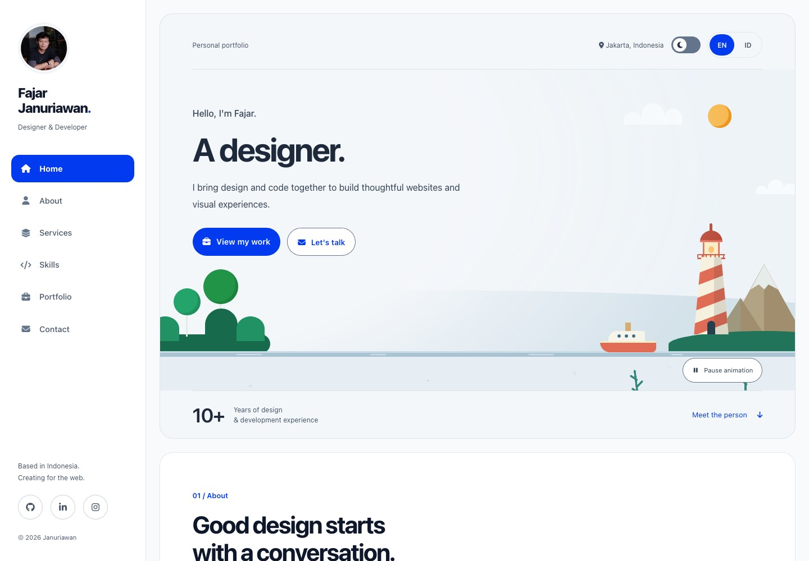
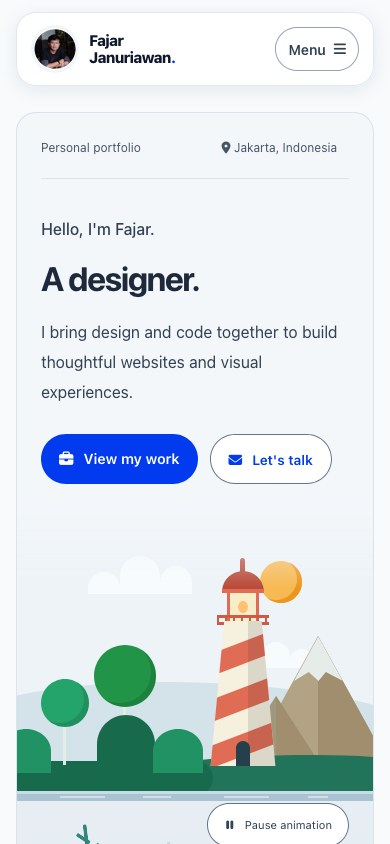

# Fajar Januriawan

Portofolio Fajar Januriawan, desainer dan pengembang web yang berbasis di Jakarta.

[Website](https://januriawan.my.id/) · [GitHub](https://github.com/januriawan)

## Tampilan terbaru



<details>
<summary>Tampilan mobile</summary>



</details>

Screenshot diambil dari versi lokal pada 11 November 2026.

## Fitur

- Pilihan English dan Bahasa Indonesia, serta dark mode. Pilihan bahasa dan tema tersimpan di browser.
- Direktori 41 proyek dengan 12 preview, pencarian, filter instansi, detail proyek, dan tampilan gambar penuh.
- Daftar keahlian dalam tujuh kategori, termasuk AI, web, mobile/GIS, basis data, Server & DevOps, infrastruktur, dan desain.
- Sidebar desktop dan navbar melayang di mobile dengan panel menu geser. Avatar menampilkan badge Open to Work saat hover atau fokus keyboard.
- Slider partner menggunakan Swiper, dengan autoplay dan looping di mobile.
- Animasi ilustrasi pantai pada hero dan siluet Jakarta pada Contact, termasuk Monas, gedung Kemendag, KRL, kendaraan, halte, dan pejalan kaki. Animasi menyesuaikan pengaturan reduced motion.
- Formulir kontak menyiapkan draf di aplikasi email pengguna. Pengguna mengirim email melalui aplikasi tersebut.

## Menjalankan secara lokal

Jalankan perintah berikut dari direktori project:

```sh
python3 -m http.server 8000
```

Buka [localhost:8000](http://localhost:8000/). Project juga dapat dijalankan melalui MAMP.

Website menggunakan HTML, CSS, dan JavaScript, dengan Swiper dan Font Awesome yang disimpan secara lokal.

## Struktur project

| Lokasi | Isi |
| --- | --- |
| `index.html` | Konten halaman, daftar skill, proyek, dan ilustrasi SVG |
| `css/` | Gaya halaman, tema, animasi, dan stylesheet vendor |
| `js/` | Interaksi, terjemahan EN/ID, galeri proyek, dan Swiper |
| `img/` | Foto profil, logo partner, preview proyek, favicon, dan screenshot README |

Konten utama dapat diperbarui di `index.html`; pasangan terjemahan berada di `js/i18n.js`.

Lisensi project tersedia di [LICENSE](LICENSE). Lisensi vendor disertakan pada folder masing-masing.
